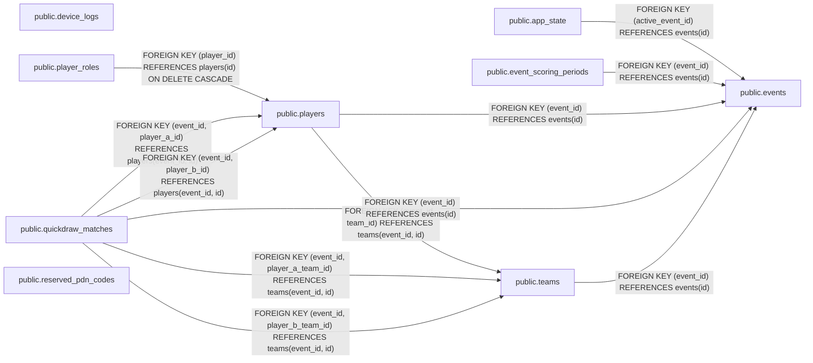

# Database schema reference (generated)

This file is an automatically generated catalog of tables, columns, constraints, and indexes, not a database usage guide.

Generated from the repository’s migrations. After changing migrations, run `cargo xtask docs db` with Docker running, then commit the updated documentation. Do not edit this file manually.

[View the complete SQL schema](schema.sql).

## Relationships

Arrows point from the referencing table to the referenced table. Labels show foreign key definitions; cardinality is not inferred.

## Enum types

| Type | Values |
| --- | --- |
| public.player_role | staff, courier, miniboss |
| public.quickdraw_scoring_status | scoring, same_team, scoring_disabled, unassigned_team |

## public.app_state

| Column | Type | Nullable | Default | Description |
| --- | --- | --- | --- | --- |
| id | integer | no |  |  |
| active_event_id | uuid | yes |  |  |

### Constraints

| Name | Definition |
| --- | --- |
| app_state_active_event_id_fkey | FOREIGN KEY (active_event_id) REFERENCES events(id) |
| app_state_id_check | CHECK ((id = 1)) |
| app_state_id_not_null | NOT NULL id |
| app_state_pkey | PRIMARY KEY (id) |

### Indexes

| Definition |
| --- |
| CREATE UNIQUE INDEX app_state_pkey ON public.app_state USING btree (id) |

## public.device_logs

| Column | Type | Nullable | Default | Description |
| --- | --- | --- | --- | --- |
| id | uuid | no | gen_random_uuid() |  |
| device_mac | macaddr | no |  |  |
| crash_number | bigint | no |  |  |
| uptime_ms | bigint | no |  |  |
| received_at | timestamp with time zone | no | now() |  |
| software_version | text | yes |  |  |
| reset_reason | integer | no |  |  |
| program_counter | bigint | yes |  |  |
| exception_cause | bigint | yes |  |  |
| task_name | text | yes |  |  |

### Constraints

| Name | Definition |
| --- | --- |
| device_logs_crash_number_check | CHECK ((crash_number &gt;= 0)) |
| device_logs_crash_number_not_null | NOT NULL crash_number |
| device_logs_device_mac_crash_number_key | UNIQUE (device_mac, crash_number) |
| device_logs_device_mac_not_null | NOT NULL device_mac |
| device_logs_exception_cause_check | CHECK (((exception_cause &gt;= 0) AND (exception_cause &lt;= '4294967295'::bigint))) |
| device_logs_id_not_null | NOT NULL id |
| device_logs_pkey | PRIMARY KEY (id) |
| device_logs_program_counter_check | CHECK (((program_counter &gt;= 0) AND (program_counter &lt;= '4294967295'::bigint))) |
| device_logs_received_at_not_null | NOT NULL received_at |
| device_logs_reset_reason_check | CHECK ((reset_reason &gt;= 0)) |
| device_logs_reset_reason_not_null | NOT NULL reset_reason |
| device_logs_uptime_ms_check | CHECK ((uptime_ms &gt;= 0)) |
| device_logs_uptime_ms_not_null | NOT NULL uptime_ms |

### Indexes

| Definition |
| --- |
| CREATE UNIQUE INDEX device_logs_device_mac_crash_number_key ON public.device_logs USING btree (device_mac, crash_number) |
| CREATE UNIQUE INDEX device_logs_pkey ON public.device_logs USING btree (id) |

## public.event_scoring_periods

Event scoring history. Opening creates a row; closing fills closes_at. Match eligibility uses device occurrence time, not upload time. No unclosed period means scoring is disabled.

| Column | Type | Nullable | Default | Description |
| --- | --- | --- | --- | --- |
| id | uuid | no | gen_random_uuid() |  |
| event_id | uuid | no |  |  |
| started_at | timestamp with time zone | no | clock_timestamp() | Inclusive scoring start instant. Stored as timestamptz; devices report UTC. |
| closes_at | timestamp with time zone | yes |  | Exclusive scoring end instant. NULL means this period is still open. Closing a period preserves its history. |

### Constraints

| Name | Definition |
| --- | --- |
| event_scoring_periods_event_id_fkey | FOREIGN KEY (event_id) REFERENCES events(id) |
| event_scoring_periods_event_id_not_null | NOT NULL event_id |
| event_scoring_periods_finite_times | CHECK ((isfinite(started_at) AND ((closes_at IS NULL) OR isfinite(closes_at)))) |
| event_scoring_periods_id_not_null | NOT NULL id |
| event_scoring_periods_no_overlap | EXCLUDE USING gist (event_id WITH =, tstzrange(started_at, closes_at, '[)'::text) WITH &amp;&amp;) |
| event_scoring_periods_pkey | PRIMARY KEY (id) |
| event_scoring_periods_started_at_not_null | NOT NULL started_at |
| event_scoring_periods_time_order | CHECK ((closes_at &gt; started_at)) |

### Indexes

| Definition |
| --- |
| CREATE INDEX event_scoring_periods_no_overlap ON public.event_scoring_periods USING gist (event_id, tstzrange(started_at, closes_at, '[)'::text)) |
| CREATE UNIQUE INDEX event_scoring_periods_pkey ON public.event_scoring_periods USING btree (id) |

## public.events

| Column | Type | Nullable | Default | Description |
| --- | --- | --- | --- | --- |
| id | uuid | no |  |  |
| name | text | no |  |  |
| venue_name | text | yes |  |  |
| next_pdn_code | integer | no | 1 |  |
| created_at | timestamp with time zone | no |  |  |

### Constraints

| Name | Definition |
| --- | --- |
| events_created_at_not_null | NOT NULL created_at |
| events_id_not_null | NOT NULL id |
| events_name_not_null | NOT NULL name |
| events_next_pdn_code_check | CHECK (((next_pdn_code &gt;= 1) AND (next_pdn_code &lt;= 10000))) |
| events_next_pdn_code_not_null | NOT NULL next_pdn_code |
| events_pkey | PRIMARY KEY (id) |

### Indexes

| Definition |
| --- |
| CREATE UNIQUE INDEX events_pkey ON public.events USING btree (id) |

## public.player_roles

| Column | Type | Nullable | Default | Description |
| --- | --- | --- | --- | --- |
| player_id | uuid | no |  |  |
| role | player_role | no |  |  |

### Constraints

| Name | Definition |
| --- | --- |
| player_roles_pkey | PRIMARY KEY (player_id, role) |
| player_roles_player_id_fkey | FOREIGN KEY (player_id) REFERENCES players(id) ON DELETE CASCADE |
| player_roles_player_id_not_null | NOT NULL player_id |
| player_roles_role_not_null | NOT NULL role |

### Indexes

| Definition |
| --- |
| CREATE UNIQUE INDEX player_roles_pkey ON public.player_roles USING btree (player_id, role) |

## public.players

| Column | Type | Nullable | Default | Description |
| --- | --- | --- | --- | --- |
| id | uuid | no |  |  |
| pdn_code | text | no |  |  |
| name | text | no |  |  |
| email | text | yes |  |  |
| created_at | timestamp with time zone | no |  |  |
| event_id | uuid | no |  |  |
| team_id | uuid | yes |  |  |

### Constraints

| Name | Definition |
| --- | --- |
| players_created_at_not_null | NOT NULL created_at |
| players_event_id_fkey | FOREIGN KEY (event_id) REFERENCES events(id) |
| players_event_id_key | UNIQUE (event_id, id) |
| players_event_id_not_null | NOT NULL event_id |
| players_event_name_key | UNIQUE (event_id, name) |
| players_event_pdn_code_key | UNIQUE (event_id, pdn_code) |
| players_event_team_fkey | FOREIGN KEY (event_id, team_id) REFERENCES teams(event_id, id) |
| players_id_not_null | NOT NULL id |
| players_name_not_null | NOT NULL name |
| players_pdn_code_check | CHECK ((pdn_code ~ '^[0-9]{4}$'::text)) |
| players_pdn_code_not_null | NOT NULL pdn_code |
| players_pkey | PRIMARY KEY (id) |

### Indexes

| Definition |
| --- |
| CREATE INDEX players_event_created_at_id_idx ON public.players USING btree (event_id, created_at DESC, id DESC) |
| CREATE UNIQUE INDEX players_event_id_key ON public.players USING btree (event_id, id) |
| CREATE UNIQUE INDEX players_event_name_key ON public.players USING btree (event_id, name) |
| CREATE UNIQUE INDEX players_event_pdn_code_key ON public.players USING btree (event_id, pdn_code) |
| CREATE UNIQUE INDEX players_pkey ON public.players USING btree (id) |

## public.quickdraw_matches

Completed two-player quickdraw results, including non-scoring duels. Ingestion must use INSERT ... ON CONFLICT (id) DO NOTHING: the first accepted report and its device timestamp win. No per-device reports or leaderboard totals are stored.

| Column | Type | Nullable | Default | Description |
| --- | --- | --- | --- | --- |
| id | uuid | no |  |  |
| event_id | uuid | no |  |  |
| player_a_id | uuid | no |  | First participant slot, not a Hunter/Bounty role. Device reports must identify the same shared duel ID. |
| player_b_id | uuid | no |  |  |
| player_a_team_id | uuid | yes |  | Team credited at match time, supplied by ingestion; NULL means unassigned. Historical snapshot, not a reference to current player membership. |
| player_b_team_id | uuid | yes |  | Team credited at match time, supplied by ingestion; NULL means unassigned. Historical snapshot, not a reference to current player membership. |
| player_a_draw_time_ms | bigint | no |  | Device-measured draw duration in milliseconds. Nonnegative; zero is a measurement, not a missing-value sentinel. |
| player_b_draw_time_ms | bigint | no |  | Device-measured draw duration in milliseconds. Nonnegative; zero is a measurement, not a missing-value sentinel. |
| winner_player_id | uuid | no |  | Explicit device-reported winner; must be one of the two participants. No inferred winner from draw times. |
| occurred_at | timestamp with time zone | no |  | Trusted UTC device timestamp from the first accepted upload. Use for scoring periods, daily boundaries and match chronology. |
| received_at | timestamp with time zone | no | clock_timestamp() | Defaults to the database clock at insertion. Ingestion must omit this field and preserve the first accepted result on duplicate uploads. Not the time used for scoring eligibility. |
| scoring_status | quickdraw_scoring_status | no |  | Scoring decision supplied by ingestion and stored with the first accepted result. Use event and device occurrence time to check scoring periods: no matching period -&gt; scoring_disabled; either team missing -&gt; unassigned_team; equal teams -&gt; same_team; otherwise scoring. No period reference is retained. The database checks team consistency; period lookup belongs to ingestion. |

### Constraints

| Name | Definition |
| --- | --- |
| quickdraw_matches_distinct_players | CHECK ((player_a_id &lt;&gt; player_b_id)) |
| quickdraw_matches_event_id_fkey | FOREIGN KEY (event_id) REFERENCES events(id) |
| quickdraw_matches_event_id_not_null | NOT NULL event_id |
| quickdraw_matches_id_not_null | NOT NULL id |
| quickdraw_matches_occurred_at_check | CHECK (isfinite(occurred_at)) |
| quickdraw_matches_occurred_at_not_null | NOT NULL occurred_at |
| quickdraw_matches_pkey | PRIMARY KEY (id) |
| quickdraw_matches_player_a_draw_time_ms_check | CHECK ((player_a_draw_time_ms &gt;= 0)) |
| quickdraw_matches_player_a_draw_time_ms_not_null | NOT NULL player_a_draw_time_ms |
| quickdraw_matches_player_a_fkey | FOREIGN KEY (event_id, player_a_id) REFERENCES players(event_id, id) |
| quickdraw_matches_player_a_id_not_null | NOT NULL player_a_id |
| quickdraw_matches_player_b_draw_time_ms_check | CHECK ((player_b_draw_time_ms &gt;= 0)) |
| quickdraw_matches_player_b_draw_time_ms_not_null | NOT NULL player_b_draw_time_ms |
| quickdraw_matches_player_b_fkey | FOREIGN KEY (event_id, player_b_id) REFERENCES players(event_id, id) |
| quickdraw_matches_player_b_id_not_null | NOT NULL player_b_id |
| quickdraw_matches_received_at_check | CHECK (isfinite(received_at)) |
| quickdraw_matches_received_at_not_null | NOT NULL received_at |
| quickdraw_matches_scoring_status_not_null | NOT NULL scoring_status |
| quickdraw_matches_scoring_teams_check | CHECK (((scoring_status = 'scoring_disabled'::quickdraw_scoring_status) OR (scoring_status = CASE     WHEN ((player_a_team_id IS NULL) OR (player_b_team_id IS NULL)) THEN 'unassigned_team'::quickdraw_scoring_status     WHEN (player_a_team_id = player_b_team_id) THEN 'same_team'::quickdraw_scoring_status     ELSE 'scoring'::quickdraw_scoring_status END))) |
| quickdraw_matches_team_a_fkey | FOREIGN KEY (event_id, player_a_team_id) REFERENCES teams(event_id, id) |
| quickdraw_matches_team_b_fkey | FOREIGN KEY (event_id, player_b_team_id) REFERENCES teams(event_id, id) |
| quickdraw_matches_winner_is_participant | CHECK (((winner_player_id = player_a_id) OR (winner_player_id = player_b_id))) |
| quickdraw_matches_winner_player_id_not_null | NOT NULL winner_player_id |

### Indexes

| Definition |
| --- |
| CREATE INDEX quickdraw_matches_event_occurred_at_id_idx ON public.quickdraw_matches USING btree (event_id, occurred_at DESC, id DESC) |
| CREATE UNIQUE INDEX quickdraw_matches_pkey ON public.quickdraw_matches USING btree (id) |
| CREATE INDEX quickdraw_matches_player_a_history_idx ON public.quickdraw_matches USING btree (event_id, player_a_id, occurred_at, id) |
| CREATE INDEX quickdraw_matches_player_b_history_idx ON public.quickdraw_matches USING btree (event_id, player_b_id, occurred_at, id) |

## public.reserved_pdn_codes

| Column | Type | Nullable | Default | Description |
| --- | --- | --- | --- | --- |
| code | text | no |  |  |
| reason | text | yes |  |  |

### Constraints

| Name | Definition |
| --- | --- |
| reserved_pdn_codes_code_check | CHECK ((code ~ '^[0-9]{4}$'::text)) |
| reserved_pdn_codes_code_not_null | NOT NULL code |
| reserved_pdn_codes_pkey | PRIMARY KEY (code) |

### Indexes

| Definition |
| --- |
| CREATE UNIQUE INDEX reserved_pdn_codes_pkey ON public.reserved_pdn_codes USING btree (code) |

## public.teams

| Column | Type | Nullable | Default | Description |
| --- | --- | --- | --- | --- |
| id | uuid | no | gen_random_uuid() |  |
| event_id | uuid | no |  |  |
| name | text | no |  |  |

### Constraints

| Name | Definition |
| --- | --- |
| teams_event_id_fkey | FOREIGN KEY (event_id) REFERENCES events(id) |
| teams_event_id_key | UNIQUE (event_id, id) |
| teams_event_id_not_null | NOT NULL event_id |
| teams_event_name_key | UNIQUE (event_id, name) |
| teams_id_not_null | NOT NULL id |
| teams_name_check | CHECK (((name &lt;&gt; ''::text) AND (name = btrim(name)))) |
| teams_name_not_null | NOT NULL name |
| teams_pkey | PRIMARY KEY (id) |

### Indexes

| Definition |
| --- |
| CREATE UNIQUE INDEX teams_event_id_key ON public.teams USING btree (event_id, id) |
| CREATE UNIQUE INDEX teams_event_name_key ON public.teams USING btree (event_id, name) |
| CREATE UNIQUE INDEX teams_pkey ON public.teams USING btree (id) |
