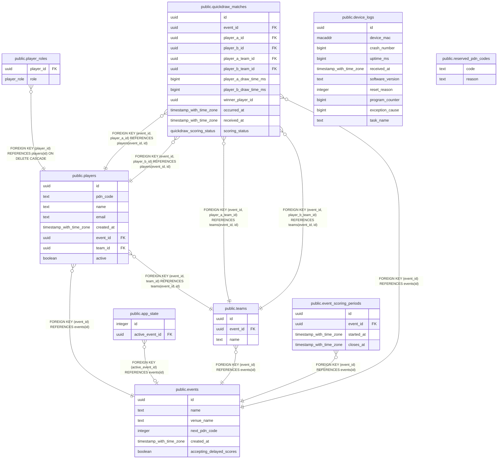

# Alleycat database

## Description

Generated from migrations with tbls. Run `cargo xtask docs db` to regenerate;  
do not edit these files manually.  
  
[Complete PostgreSQL schema, including enum values and routines](../schema.sql).  
[Architecture decisions](../../adr/README.md).  

## Tables

| Name | Columns | Comment | Type |
| ---- | ------- | ------- | ---- |
| [public.players](public.players.md) | 8 |  | BASE TABLE |
| [public.player_roles](public.player_roles.md) | 2 |  | BASE TABLE |
| [public.device_logs](public.device_logs.md) | 10 |  | BASE TABLE |
| [public.events](public.events.md) | 6 |  | BASE TABLE |
| [public.reserved_pdn_codes](public.reserved_pdn_codes.md) | 2 |  | BASE TABLE |
| [public.app_state](public.app_state.md) | 2 |  | BASE TABLE |
| [public.teams](public.teams.md) | 3 |  | BASE TABLE |
| [public.event_scoring_periods](public.event_scoring_periods.md) | 4 | Event scoring history. Opening creates a row; closing fills closes_at. Match eligibility uses device occurrence time, not upload time. No unclosed period means scoring is disabled. | BASE TABLE |
| [public.quickdraw_matches](public.quickdraw_matches.md) | 12 | Completed two-player quickdraw results, including non-scoring duels. Ingestion must use INSERT ... ON CONFLICT (id) DO NOTHING: the first accepted report and its device timestamp win. No per-device reports or leaderboard totals are stored. | BASE TABLE |

## Stored procedures and functions

| Name | ReturnType | Arguments | Type |
| ---- | ------- | ------- | ---- |
| public.event_uuid_range | event_uuid_range | uuid, uuid | FUNCTION |
| public.event_uuid_range | event_uuid_range | uuid, uuid, text | FUNCTION |
| public.event_uuid_multirange | event_uuid_multirange |  | FUNCTION |
| public.event_uuid_multirange | event_uuid_multirange | event_uuid_range | FUNCTION |
| public.event_uuid_multirange | event_uuid_multirange | VARIADIC event_uuid_range[] | FUNCTION |

## Enums

| Name | Values |
| ---- | ------- |
| public.player_role | courier, miniboss, staff |
| public.quickdraw_scoring_status | delayed_scores_disabled, same_team, scoring, scoring_disabled, unassigned_team |

## Relations

---

> Generated by [tbls](https://github.com/k1LoW/tbls)
