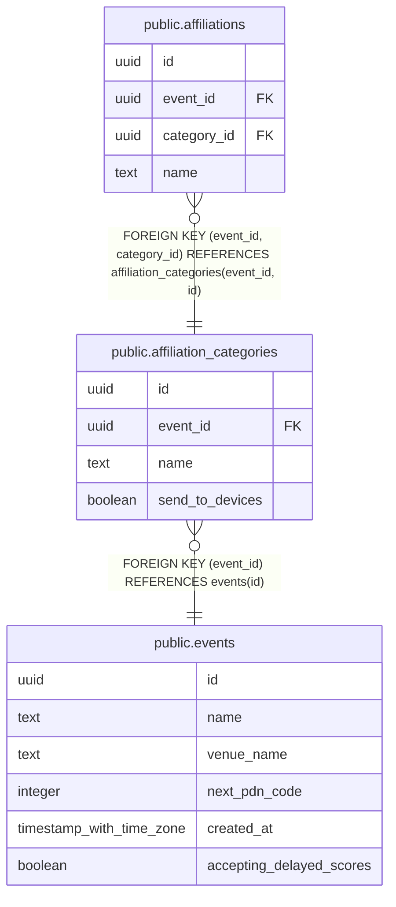

# public.affiliation_categories

## Description

Operator-defined affiliation categories within an event. No seeded categories or implied gameplay behavior.

## Columns

| Name | Type | Default | Nullable | Children | Parents | Comment |
| ---- | ---- | ------- | -------- | -------- | ------- | ------- |
| id | uuid | gen_random_uuid() | false | [public.affiliations](public.affiliations.md) |  |  |
| event_id | uuid |  | false | [public.affiliations](public.affiliations.md) | [public.events](public.events.md) |  |
| name | text |  | false |  |  |  |
| send_to_devices | boolean | false | false |  |  | Include assignments in this category in device player lookups. Defaults to false; staff responses always include all assignments. |

## Constraints

| Name | Type | Definition |
| ---- | ---- | ---------- |
| affiliation_categories_event_id_not_null | n | NOT NULL event_id |
| affiliation_categories_id_not_null | n | NOT NULL id |
| affiliation_categories_name_check | CHECK | CHECK (((name <> ''::text) AND (name = btrim(name)) AND (char_length(name) <= 256))) |
| affiliation_categories_name_not_null | n | NOT NULL name |
| affiliation_categories_send_to_devices_not_null | n | NOT NULL send_to_devices |
| affiliation_categories_event_id_fkey | FOREIGN KEY | FOREIGN KEY (event_id) REFERENCES events(id) |
| affiliation_categories_pkey | PRIMARY KEY | PRIMARY KEY (id) |
| affiliation_categories_event_name_key | UNIQUE | UNIQUE (event_id, name) |
| affiliation_categories_event_id_key | UNIQUE | UNIQUE (event_id, id) |

## Indexes

| Name | Definition |
| ---- | ---------- |
| affiliation_categories_pkey | CREATE UNIQUE INDEX affiliation_categories_pkey ON public.affiliation_categories USING btree (id) |
| affiliation_categories_event_name_key | CREATE UNIQUE INDEX affiliation_categories_event_name_key ON public.affiliation_categories USING btree (event_id, name) |
| affiliation_categories_event_id_key | CREATE UNIQUE INDEX affiliation_categories_event_id_key ON public.affiliation_categories USING btree (event_id, id) |

## Relations

---

> Generated by [tbls](https://github.com/k1LoW/tbls)
