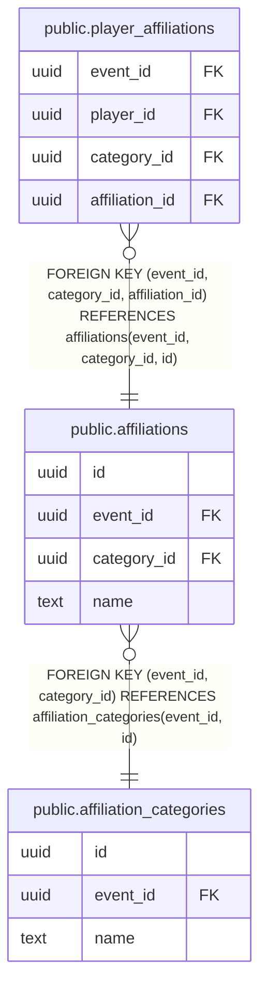

# public.affiliations

## Description

Operator-defined affiliations within a category. Names have no implicit gameplay or permission behavior.

## Columns

| Name | Type | Default | Nullable | Children | Parents | Comment |
| ---- | ---- | ------- | -------- | -------- | ------- | ------- |
| id | uuid | gen_random_uuid() | false | [public.player_affiliations](public.player_affiliations.md) |  |  |
| event_id | uuid |  | false | [public.player_affiliations](public.player_affiliations.md) | [public.affiliation_categories](public.affiliation_categories.md) |  |
| category_id | uuid |  | false | [public.player_affiliations](public.player_affiliations.md) | [public.affiliation_categories](public.affiliation_categories.md) |  |
| name | text |  | false |  |  |  |

## Constraints

| Name | Type | Definition |
| ---- | ---- | ---------- |
| affiliations_category_id_not_null | n | NOT NULL category_id |
| affiliations_event_id_not_null | n | NOT NULL event_id |
| affiliations_id_not_null | n | NOT NULL id |
| affiliations_name_check | CHECK | CHECK (((name <> ''::text) AND (name = btrim(name)) AND (char_length(name) <= 256))) |
| affiliations_name_not_null | n | NOT NULL name |
| affiliations_category_fkey | FOREIGN KEY | FOREIGN KEY (event_id, category_id) REFERENCES affiliation_categories(event_id, id) |
| affiliations_pkey | PRIMARY KEY | PRIMARY KEY (id) |
| affiliations_category_name_key | UNIQUE | UNIQUE (category_id, name) |
| affiliations_event_category_id_key | UNIQUE | UNIQUE (event_id, category_id, id) |

## Indexes

| Name | Definition |
| ---- | ---------- |
| affiliations_pkey | CREATE UNIQUE INDEX affiliations_pkey ON public.affiliations USING btree (id) |
| affiliations_category_name_key | CREATE UNIQUE INDEX affiliations_category_name_key ON public.affiliations USING btree (category_id, name) |
| affiliations_event_category_id_key | CREATE UNIQUE INDEX affiliations_event_category_id_key ON public.affiliations USING btree (event_id, category_id, id) |

## Relations

---

> Generated by [tbls](https://github.com/k1LoW/tbls)
