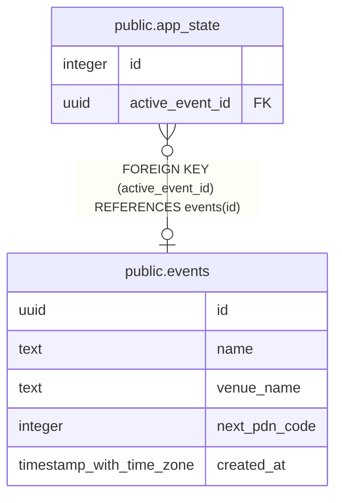

# public.app_state

## Columns

| Name | Type | Default | Nullable | Children | Parents | Comment |
| ---- | ---- | ------- | -------- | -------- | ------- | ------- |
| id | integer |  | false |  |  |  |
| active_event_id | uuid |  | true |  | [public.events](public.events.md) |  |

## Constraints

| Name | Type | Definition |
| ---- | ---- | ---------- |
| app_state_id_check | CHECK | CHECK ((id = 1)) |
| app_state_id_not_null | n | NOT NULL id |
| app_state_active_event_id_fkey | FOREIGN KEY | FOREIGN KEY (active_event_id) REFERENCES events(id) |
| app_state_pkey | PRIMARY KEY | PRIMARY KEY (id) |

## Indexes

| Name | Definition |
| ---- | ---------- |
| app_state_pkey | CREATE UNIQUE INDEX app_state_pkey ON public.app_state USING btree (id) |

## Relations

---

> Generated by [tbls](https://github.com/k1LoW/tbls)
