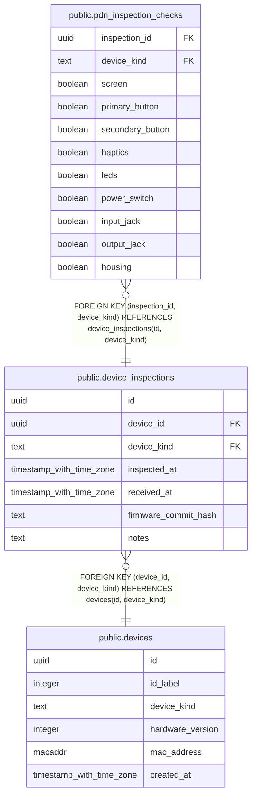

# public.device_inspections

## Description

Saved condition checks. Each row is a complete snapshot; missing checks are unknown, never inherited from earlier inspections. API writes never replace an accepted inspection.

## Columns

| Name | Type | Default | Nullable | Children | Parents | Comment |
| ---- | ---- | ------- | -------- | -------- | ------- | ------- |
| id | uuid |  | false | [public.pdn_inspection_checks](public.pdn_inspection_checks.md) |  |  |
| device_id | uuid |  | false |  | [public.devices](public.devices.md) |  |
| device_kind | text |  | false | [public.pdn_inspection_checks](public.pdn_inspection_checks.md) | [public.devices](public.devices.md) |  |
| inspected_at | timestamp with time zone |  | false |  |  | Client-reported check time in UTC. Latest condition uses this time, then received_at and ID descending to resolve ties. |
| received_at | timestamp with time zone | clock_timestamp() | false |  |  |  |
| firmware_commit_hash | text |  | true |  |  | Firmware observed during this check, not a mutable device attribute. Null means not recorded. |
| notes | text |  | true |  |  |  |

## Constraints

| Name | Type | Definition |
| ---- | ---- | ---------- |
| device_inspections_device_id_not_null | n | NOT NULL device_id |
| device_inspections_device_kind_check | CHECK | CHECK ((device_kind = 'pdn'::text)) |
| device_inspections_device_kind_not_null | n | NOT NULL device_kind |
| device_inspections_firmware_commit_hash_check | CHECK | CHECK ((((octet_length(firmware_commit_hash) >= 1) AND (octet_length(firmware_commit_hash) <= 64)) AND (btrim(firmware_commit_hash) <> ''::text))) |
| device_inspections_id_check | CHECK | CHECK ((id <> '00000000-0000-0000-0000-000000000000'::uuid)) |
| device_inspections_id_not_null | n | NOT NULL id |
| device_inspections_inspected_at_check | CHECK | CHECK (((inspected_at >= '1970-01-01 00:00:00+00'::timestamp with time zone) AND (inspected_at <= '9999-12-31 23:59:59.999+00'::timestamp with time zone))) |
| device_inspections_inspected_at_not_null | n | NOT NULL inspected_at |
| device_inspections_notes_check | CHECK | CHECK ((octet_length(notes) <= 2048)) |
| device_inspections_received_at_not_null | n | NOT NULL received_at |
| device_inspections_device_id_device_kind_fkey | FOREIGN KEY | FOREIGN KEY (device_id, device_kind) REFERENCES devices(id, device_kind) |
| device_inspections_pkey | PRIMARY KEY | PRIMARY KEY (id) |
| device_inspections_id_device_kind_key | UNIQUE | UNIQUE (id, device_kind) |

## Indexes

| Name | Definition |
| ---- | ---------- |
| device_inspections_pkey | CREATE UNIQUE INDEX device_inspections_pkey ON public.device_inspections USING btree (id) |
| device_inspections_id_device_kind_key | CREATE UNIQUE INDEX device_inspections_id_device_kind_key ON public.device_inspections USING btree (id, device_kind) |
| device_inspections_latest_idx | CREATE INDEX device_inspections_latest_idx ON public.device_inspections USING btree (device_id, inspected_at DESC, received_at DESC, id DESC) |

## Relations

---

> Generated by [tbls](https://github.com/k1LoW/tbls)
