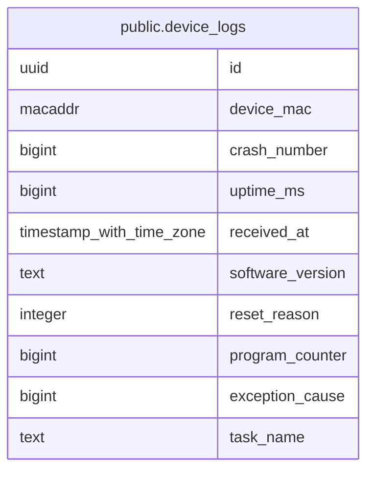

# public.device_logs

## Columns

| Name | Type | Default | Nullable | Children | Parents | Comment |
| ---- | ---- | ------- | -------- | -------- | ------- | ------- |
| id | uuid | gen_random_uuid() | false |  |  |  |
| device_mac | macaddr |  | false |  |  |  |
| crash_number | bigint |  | false |  |  |  |
| uptime_ms | bigint |  | false |  |  |  |
| received_at | timestamp with time zone | now() | false |  |  |  |
| software_version | text |  | true |  |  |  |
| reset_reason | integer |  | false |  |  |  |
| program_counter | bigint |  | true |  |  |  |
| exception_cause | bigint |  | true |  |  |  |
| task_name | text |  | true |  |  |  |

## Constraints

| Name | Type | Definition |
| ---- | ---- | ---------- |
| device_logs_crash_number_check | CHECK | CHECK ((crash_number >= 0)) |
| device_logs_crash_number_not_null | n | NOT NULL crash_number |
| device_logs_device_mac_not_null | n | NOT NULL device_mac |
| device_logs_exception_cause_check | CHECK | CHECK (((exception_cause >= 0) AND (exception_cause <= '4294967295'::bigint))) |
| device_logs_id_not_null | n | NOT NULL id |
| device_logs_program_counter_check | CHECK | CHECK (((program_counter >= 0) AND (program_counter <= '4294967295'::bigint))) |
| device_logs_received_at_not_null | n | NOT NULL received_at |
| device_logs_reset_reason_check | CHECK | CHECK ((reset_reason >= 0)) |
| device_logs_reset_reason_not_null | n | NOT NULL reset_reason |
| device_logs_uptime_ms_check | CHECK | CHECK ((uptime_ms >= 0)) |
| device_logs_uptime_ms_not_null | n | NOT NULL uptime_ms |
| device_logs_pkey | PRIMARY KEY | PRIMARY KEY (id) |
| device_logs_device_mac_crash_number_key | UNIQUE | UNIQUE (device_mac, crash_number) |

## Indexes

| Name | Definition |
| ---- | ---------- |
| device_logs_pkey | CREATE UNIQUE INDEX device_logs_pkey ON public.device_logs USING btree (id) |
| device_logs_device_mac_crash_number_key | CREATE UNIQUE INDEX device_logs_device_mac_crash_number_key ON public.device_logs USING btree (device_mac, crash_number) |

## Relations

---

> Generated by [tbls](https://github.com/k1LoW/tbls)
