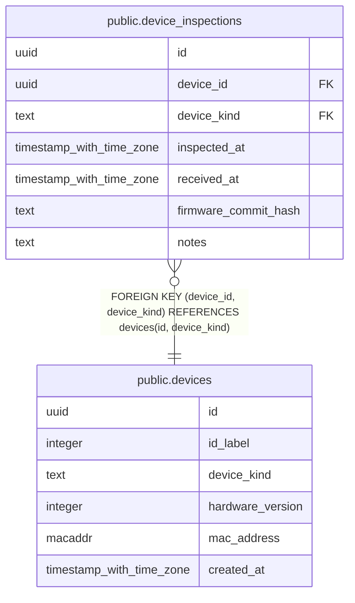

# public.devices

## Description

Physical device inventory shared across events. IDs and printed labels identify devices independently of inspection history. Currently supports PDNs.

## Columns

| Name | Type | Default | Nullable | Children | Parents | Comment |
| ---- | ---- | ------- | -------- | -------- | ------- | ------- |
| id | uuid |  | false | [public.device_inspections](public.device_inspections.md) |  |  |
| id_label | integer |  | false |  |  |  |
| device_kind | text | 'pdn'::text | false | [public.device_inspections](public.device_inspections.md) |  |  |
| hardware_version | integer |  | true |  |  |  |
| mac_address | macaddr |  | true |  |  | Optional 48-bit hardware address. Unique when known; not the permanent inventory identity. |
| created_at | timestamp with time zone | clock_timestamp() | false |  |  |  |

## Constraints

| Name | Type | Definition |
| ---- | ---- | ---------- |
| devices_created_at_not_null | n | NOT NULL created_at |
| devices_device_kind_check | CHECK | CHECK ((device_kind = 'pdn'::text)) |
| devices_device_kind_not_null | n | NOT NULL device_kind |
| devices_hardware_version_check | CHECK | CHECK ((hardware_version > 0)) |
| devices_id_check | CHECK | CHECK ((id <> '00000000-0000-0000-0000-000000000000'::uuid)) |
| devices_id_label_check | CHECK | CHECK (((id_label >= 1) AND (id_label <= 9999))) |
| devices_id_label_not_null | n | NOT NULL id_label |
| devices_id_not_null | n | NOT NULL id |
| devices_pkey | PRIMARY KEY | PRIMARY KEY (id) |
| devices_id_label_key | UNIQUE | UNIQUE (id_label) |
| devices_mac_address_key | UNIQUE | UNIQUE (mac_address) |
| devices_id_device_kind_key | UNIQUE | UNIQUE (id, device_kind) |

## Indexes

| Name | Definition |
| ---- | ---------- |
| devices_pkey | CREATE UNIQUE INDEX devices_pkey ON public.devices USING btree (id) |
| devices_id_label_key | CREATE UNIQUE INDEX devices_id_label_key ON public.devices USING btree (id_label) |
| devices_mac_address_key | CREATE UNIQUE INDEX devices_mac_address_key ON public.devices USING btree (mac_address) |
| devices_id_device_kind_key | CREATE UNIQUE INDEX devices_id_device_kind_key ON public.devices USING btree (id, device_kind) |

## Relations

---

> Generated by [tbls](https://github.com/k1LoW/tbls)
