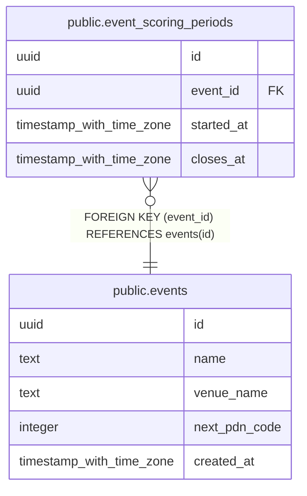

# public.event_scoring_periods

## Description

Event scoring history. Opening creates a row; closing fills closes_at. Match eligibility uses device occurrence time, not upload time. No unclosed period means scoring is disabled.

## Columns

| Name | Type | Default | Nullable | Children | Parents | Comment |
| ---- | ---- | ------- | -------- | -------- | ------- | ------- |
| id | uuid | gen_random_uuid() | false |  |  |  |
| event_id | uuid |  | false |  | [public.events](public.events.md) |  |
| started_at | timestamp with time zone | clock_timestamp() | false |  |  | Inclusive scoring start instant. Stored as timestamptz; devices report UTC. |
| closes_at | timestamp with time zone |  | true |  |  | Exclusive scoring end instant. NULL means this period is still open. Closing a period preserves its history. |

## Constraints

| Name | Type | Definition |
| ---- | ---- | ---------- |
| event_scoring_periods_event_id_not_null | n | NOT NULL event_id |
| event_scoring_periods_finite_times | CHECK | CHECK ((isfinite(started_at) AND ((closes_at IS NULL) OR isfinite(closes_at)))) |
| event_scoring_periods_id_not_null | n | NOT NULL id |
| event_scoring_periods_started_at_not_null | n | NOT NULL started_at |
| event_scoring_periods_time_order | CHECK | CHECK ((closes_at > started_at)) |
| event_scoring_periods_event_id_fkey | FOREIGN KEY | FOREIGN KEY (event_id) REFERENCES events(id) |
| event_scoring_periods_pkey | PRIMARY KEY | PRIMARY KEY (id) |
| event_scoring_periods_no_overlap | x | EXCLUDE USING gist (event_id WITH =, tstzrange(started_at, closes_at, '[)'::text) WITH &&) |

## Indexes

| Name | Definition |
| ---- | ---------- |
| event_scoring_periods_pkey | CREATE UNIQUE INDEX event_scoring_periods_pkey ON public.event_scoring_periods USING btree (id) |
| event_scoring_periods_no_overlap | CREATE INDEX event_scoring_periods_no_overlap ON public.event_scoring_periods USING gist (event_id, tstzrange(started_at, closes_at, '[)'::text)) |

## Relations

---

> Generated by [tbls](https://github.com/k1LoW/tbls)
