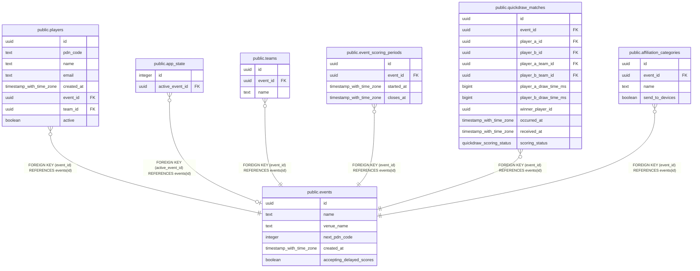

# public.events

## Columns

| Name | Type | Default | Nullable | Children | Parents | Comment |
| ---- | ---- | ------- | -------- | -------- | ------- | ------- |
| id | uuid |  | false | [public.players](public.players.md) [public.app_state](public.app_state.md) [public.teams](public.teams.md) [public.event_scoring_periods](public.event_scoring_periods.md) [public.quickdraw_matches](public.quickdraw_matches.md) [public.affiliation_categories](public.affiliation_categories.md) |  |  |
| name | text |  | false |  |  |  |
| venue_name | text |  | true |  |  |  |
| next_pdn_code | integer | 1 | false |  |  |  |
| created_at | timestamp with time zone |  | false |  |  |  |
| accepting_delayed_scores | boolean | true | false |  |  | Reversible per-event switch, default true. When false, new matches from closed scoring periods are recorded as delayed_scores_disabled. Open-period scoring and previously accepted results are unchanged. |

## Constraints

| Name | Type | Definition |
| ---- | ---- | ---------- |
| events_accepting_delayed_scores_not_null | n | NOT NULL accepting_delayed_scores |
| events_created_at_not_null | n | NOT NULL created_at |
| events_id_not_null | n | NOT NULL id |
| events_name_not_null | n | NOT NULL name |
| events_next_pdn_code_check | CHECK | CHECK (((next_pdn_code >= 1) AND (next_pdn_code <= 10000))) |
| events_next_pdn_code_not_null | n | NOT NULL next_pdn_code |
| events_pkey | PRIMARY KEY | PRIMARY KEY (id) |

## Indexes

| Name | Definition |
| ---- | ---------- |
| events_pkey | CREATE UNIQUE INDEX events_pkey ON public.events USING btree (id) |

## Relations

---

> Generated by [tbls](https://github.com/k1LoW/tbls)
