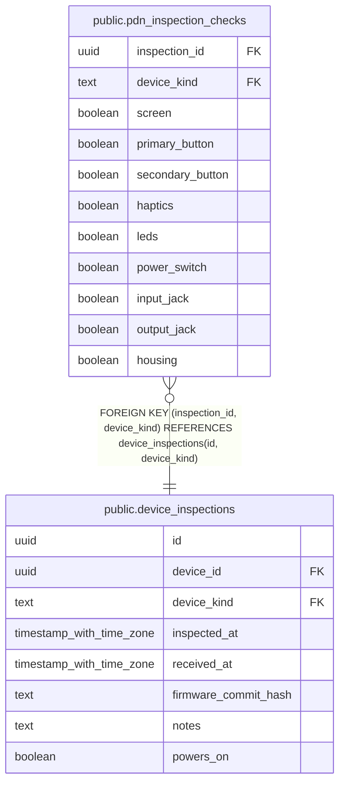

# public.pdn_inspection_checks

## Description

PDN component observations for one inspection. Shared identity, timestamps, firmware, and notes live in device_inspections. Other device classes can define their own checks.

## Columns

| Name | Type | Default | Nullable | Children | Parents | Comment |
| ---- | ---- | ------- | -------- | -------- | ------- | ------- |
| inspection_id | uuid |  | false |  | [public.device_inspections](public.device_inspections.md) |  |
| device_kind | text | 'pdn'::text | false |  | [public.device_inspections](public.device_inspections.md) |  |
| screen | boolean |  | true |  |  | True means working, false means failed, null means not checked during this inspection. |
| primary_button | boolean |  | true |  |  | True means working, false means failed, null means not checked during this inspection. |
| secondary_button | boolean |  | true |  |  | True means working, false means failed, null means not checked during this inspection. |
| haptics | boolean |  | true |  |  | True means working, false means failed, null means not checked during this inspection. |
| leds | boolean |  | true |  |  | True means working, false means failed, null means not checked during this inspection. |
| power_switch | boolean |  | true |  |  | True means working, false means failed, null means not checked during this inspection. |
| input_jack | boolean |  | true |  |  | True means working, false means failed, null means not checked during this inspection. |
| output_jack | boolean |  | true |  |  | True means working, false means failed, null means not checked during this inspection. |
| housing | boolean |  | true |  |  | True means working, false means failed, null means not checked during this inspection. |

## Constraints

| Name | Type | Definition |
| ---- | ---- | ---------- |
| pdn_inspection_checks_device_kind_check | CHECK | CHECK ((device_kind = 'pdn'::text)) |
| pdn_inspection_checks_device_kind_not_null | n | NOT NULL device_kind |
| pdn_inspection_checks_inspection_id_not_null | n | NOT NULL inspection_id |
| pdn_inspection_checks_inspection_id_device_kind_fkey | FOREIGN KEY | FOREIGN KEY (inspection_id, device_kind) REFERENCES device_inspections(id, device_kind) |
| pdn_inspection_checks_pkey | PRIMARY KEY | PRIMARY KEY (inspection_id) |

## Indexes

| Name | Definition |
| ---- | ---------- |
| pdn_inspection_checks_pkey | CREATE UNIQUE INDEX pdn_inspection_checks_pkey ON public.pdn_inspection_checks USING btree (inspection_id) |

## Relations

---

> Generated by [tbls](https://github.com/k1LoW/tbls)
