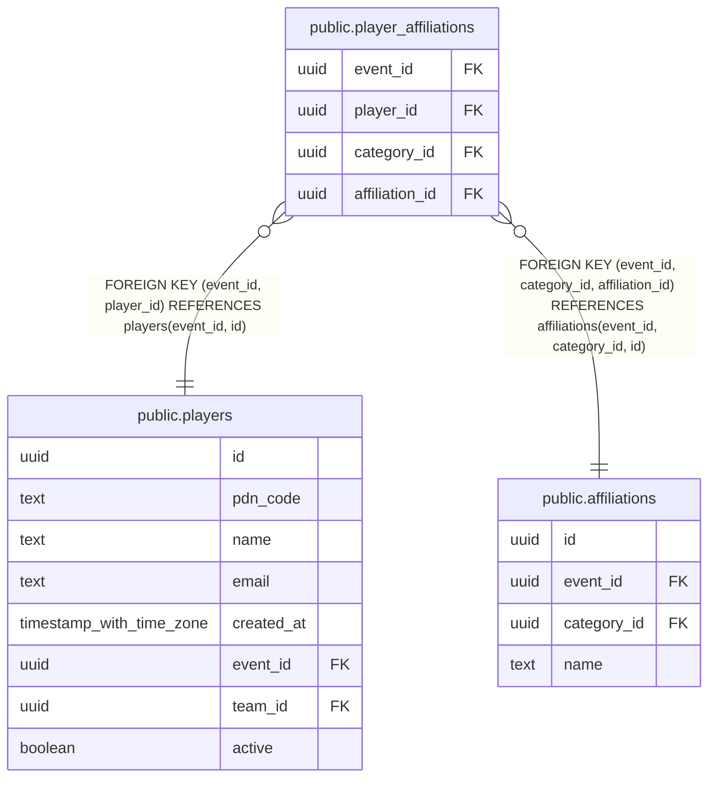

# public.player_affiliations

## Description

At most one affiliation per player per category. Composite foreign keys keep player, category, and affiliation in the same event. Clearing an assignment deletes its row; changes do not affect scores.

## Columns

| Name | Type | Default | Nullable | Children | Parents | Comment |
| ---- | ---- | ------- | -------- | -------- | ------- | ------- |
| event_id | uuid |  | false |  | [public.players](public.players.md) [public.affiliations](public.affiliations.md) |  |
| player_id | uuid |  | false |  | [public.players](public.players.md) |  |
| category_id | uuid |  | false |  | [public.affiliations](public.affiliations.md) |  |
| affiliation_id | uuid |  | false |  | [public.affiliations](public.affiliations.md) |  |

## Constraints

| Name | Type | Definition |
| ---- | ---- | ---------- |
| player_affiliations_affiliation_id_not_null | n | NOT NULL affiliation_id |
| player_affiliations_category_id_not_null | n | NOT NULL category_id |
| player_affiliations_event_id_not_null | n | NOT NULL event_id |
| player_affiliations_player_id_not_null | n | NOT NULL player_id |
| player_affiliations_player_fkey | FOREIGN KEY | FOREIGN KEY (event_id, player_id) REFERENCES players(event_id, id) |
| player_affiliations_affiliation_fkey | FOREIGN KEY | FOREIGN KEY (event_id, category_id, affiliation_id) REFERENCES affiliations(event_id, category_id, id) |
| player_affiliations_pkey | PRIMARY KEY | PRIMARY KEY (player_id, category_id) |

## Indexes

| Name | Definition |
| ---- | ---------- |
| player_affiliations_pkey | CREATE UNIQUE INDEX player_affiliations_pkey ON public.player_affiliations USING btree (player_id, category_id) |
| player_affiliations_affiliation_idx | CREATE INDEX player_affiliations_affiliation_idx ON public.player_affiliations USING btree (event_id, category_id, affiliation_id) |

## Relations

---

> Generated by [tbls](https://github.com/k1LoW/tbls)
