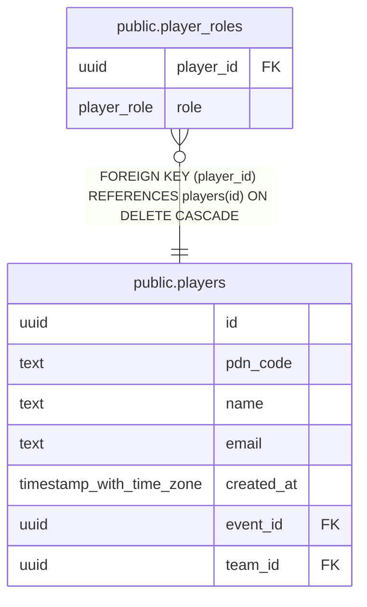

# public.player_roles

## Columns

| Name | Type | Default | Nullable | Children | Parents | Comment |
| ---- | ---- | ------- | -------- | -------- | ------- | ------- |
| player_id | uuid |  | false |  | [public.players](public.players.md) |  |
| role | player_role |  | false |  |  |  |

## Constraints

| Name | Type | Definition |
| ---- | ---- | ---------- |
| player_roles_player_id_not_null | n | NOT NULL player_id |
| player_roles_role_not_null | n | NOT NULL role |
| player_roles_player_id_fkey | FOREIGN KEY | FOREIGN KEY (player_id) REFERENCES players(id) ON DELETE CASCADE |
| player_roles_pkey | PRIMARY KEY | PRIMARY KEY (player_id, role) |

## Indexes

| Name | Definition |
| ---- | ---------- |
| player_roles_pkey | CREATE UNIQUE INDEX player_roles_pkey ON public.player_roles USING btree (player_id, role) |

## Relations

---

> Generated by [tbls](https://github.com/k1LoW/tbls)
