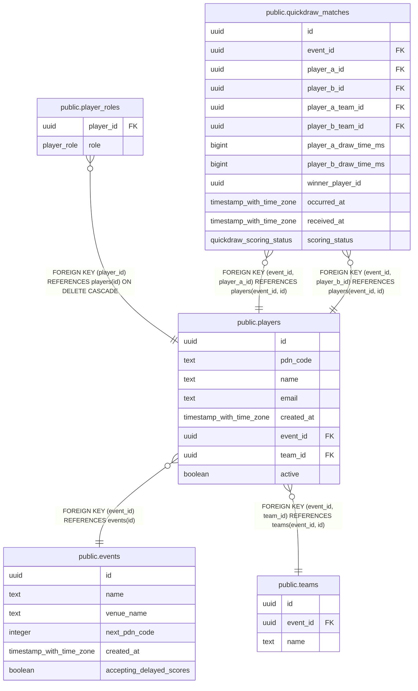

# public.players

## Columns

| Name | Type | Default | Nullable | Children | Parents | Comment |
| ---- | ---- | ------- | -------- | -------- | ------- | ------- |
| id | uuid |  | false | [public.player_roles](public.player_roles.md) [public.quickdraw_matches](public.quickdraw_matches.md) |  |  |
| pdn_code | text |  | false |  |  |  |
| name | text |  | false |  |  |  |
| email | text |  | true |  |  |  |
| created_at | timestamp with time zone |  | false |  |  |  |
| event_id | uuid |  | false | [public.quickdraw_matches](public.quickdraw_matches.md) | [public.events](public.events.md) [public.teams](public.teams.md) |  |
| team_id | uuid |  | true |  | [public.teams](public.teams.md) |  |
| active | boolean | true | false |  |  | Reversible registration/device status, initially true. Inactive players retain their PIN, name, event, and match history and remain discoverable. This flag does not change accepted scores or reject delayed match uploads. |

## Constraints

| Name | Type | Definition |
| ---- | ---- | ---------- |
| players_active_not_null | n | NOT NULL active |
| players_created_at_not_null | n | NOT NULL created_at |
| players_event_id_not_null | n | NOT NULL event_id |
| players_id_not_null | n | NOT NULL id |
| players_name_not_null | n | NOT NULL name |
| players_pdn_code_check | CHECK | CHECK ((pdn_code ~ '^[0-9]{4}$'::text)) |
| players_pdn_code_not_null | n | NOT NULL pdn_code |
| players_pkey | PRIMARY KEY | PRIMARY KEY (id) |
| players_event_id_fkey | FOREIGN KEY | FOREIGN KEY (event_id) REFERENCES events(id) |
| players_event_name_key | UNIQUE | UNIQUE (event_id, name) |
| players_event_pdn_code_key | UNIQUE | UNIQUE (event_id, pdn_code) |
| players_event_team_fkey | FOREIGN KEY | FOREIGN KEY (event_id, team_id) REFERENCES teams(event_id, id) |
| players_event_id_key | UNIQUE | UNIQUE (event_id, id) |

## Indexes

| Name | Definition |
| ---- | ---------- |
| players_pkey | CREATE UNIQUE INDEX players_pkey ON public.players USING btree (id) |
| players_event_name_key | CREATE UNIQUE INDEX players_event_name_key ON public.players USING btree (event_id, name) |
| players_event_pdn_code_key | CREATE UNIQUE INDEX players_event_pdn_code_key ON public.players USING btree (event_id, pdn_code) |
| players_event_created_at_id_idx | CREATE INDEX players_event_created_at_id_idx ON public.players USING btree (event_id, created_at DESC, id DESC) |
| players_event_id_key | CREATE UNIQUE INDEX players_event_id_key ON public.players USING btree (event_id, id) |

## Relations

---

> Generated by [tbls](https://github.com/k1LoW/tbls)
