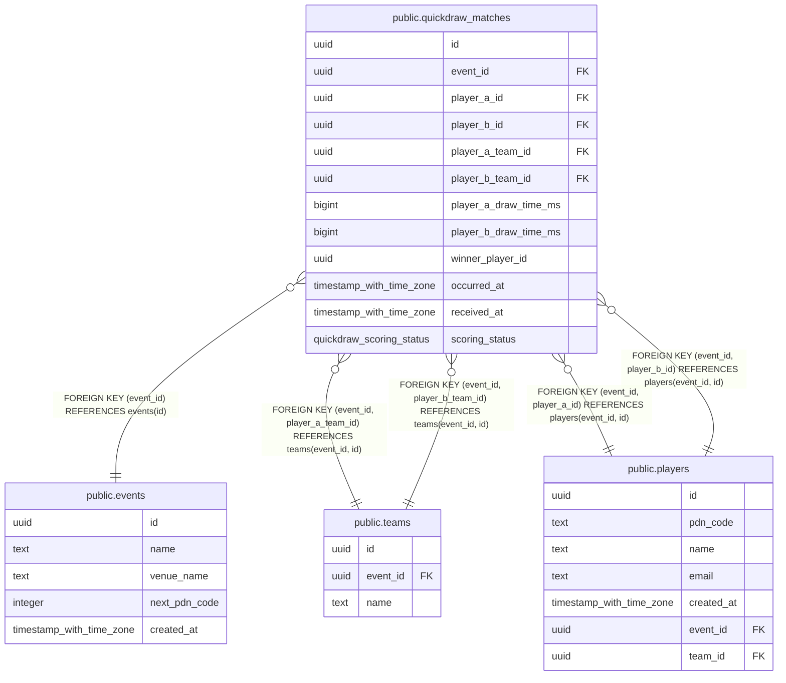

# public.quickdraw_matches

## Description

Completed two-player quickdraw results, including non-scoring duels. Ingestion must use INSERT ... ON CONFLICT (id) DO NOTHING: the first accepted report and its device timestamp win. No per-device reports or leaderboard totals are stored.

## Columns

| Name | Type | Default | Nullable | Children | Parents | Comment |
| ---- | ---- | ------- | -------- | -------- | ------- | ------- |
| id | uuid |  | false |  |  |  |
| event_id | uuid |  | false |  | [public.events](public.events.md) [public.teams](public.teams.md) [public.players](public.players.md) |  |
| player_a_id | uuid |  | false |  | [public.players](public.players.md) | First participant slot, not a Hunter/Bounty role. Device reports must identify the same shared duel ID. |
| player_b_id | uuid |  | false |  | [public.players](public.players.md) |  |
| player_a_team_id | uuid |  | true |  | [public.teams](public.teams.md) | Team credited at match time, supplied by ingestion; NULL means unassigned. Historical snapshot, not a reference to current player membership. |
| player_b_team_id | uuid |  | true |  | [public.teams](public.teams.md) | Team credited at match time, supplied by ingestion; NULL means unassigned. Historical snapshot, not a reference to current player membership. |
| player_a_draw_time_ms | bigint |  | false |  |  | Device-measured draw duration in milliseconds. Nonnegative; zero is a measurement, not a missing-value sentinel. |
| player_b_draw_time_ms | bigint |  | false |  |  | Device-measured draw duration in milliseconds. Nonnegative; zero is a measurement, not a missing-value sentinel. |
| winner_player_id | uuid |  | false |  |  | Explicit device-reported winner; must be one of the two participants. No inferred winner from draw times. |
| occurred_at | timestamp with time zone |  | false |  |  | Trusted UTC device timestamp from the first accepted upload. Use for scoring periods, daily boundaries and match chronology. |
| received_at | timestamp with time zone | clock_timestamp() | false |  |  | Defaults to the database clock at insertion. Ingestion must omit this field and preserve the first accepted result on duplicate uploads. Not the time used for scoring eligibility. |
| scoring_status | quickdraw_scoring_status |  | false |  |  | Scoring decision supplied by ingestion and stored with the first accepted result. Use event and device occurrence time to check scoring periods: no matching period -\> scoring_disabled; either team missing -\> unassigned_team; equal teams -\> same_team; otherwise scoring. No period reference is retained. The database checks team consistency; period lookup belongs to ingestion. |

## Constraints

| Name | Type | Definition |
| ---- | ---- | ---------- |
| quickdraw_matches_distinct_players | CHECK | CHECK ((player_a_id <> player_b_id)) |
| quickdraw_matches_event_id_not_null | n | NOT NULL event_id |
| quickdraw_matches_id_not_null | n | NOT NULL id |
| quickdraw_matches_occurred_at_check | CHECK | CHECK (isfinite(occurred_at)) |
| quickdraw_matches_occurred_at_not_null | n | NOT NULL occurred_at |
| quickdraw_matches_player_a_draw_time_ms_check | CHECK | CHECK ((player_a_draw_time_ms >= 0)) |
| quickdraw_matches_player_a_draw_time_ms_not_null | n | NOT NULL player_a_draw_time_ms |
| quickdraw_matches_player_a_id_not_null | n | NOT NULL player_a_id |
| quickdraw_matches_player_b_draw_time_ms_check | CHECK | CHECK ((player_b_draw_time_ms >= 0)) |
| quickdraw_matches_player_b_draw_time_ms_not_null | n | NOT NULL player_b_draw_time_ms |
| quickdraw_matches_player_b_id_not_null | n | NOT NULL player_b_id |
| quickdraw_matches_received_at_check | CHECK | CHECK (isfinite(received_at)) |
| quickdraw_matches_received_at_not_null | n | NOT NULL received_at |
| quickdraw_matches_scoring_status_not_null | n | NOT NULL scoring_status |
| quickdraw_matches_scoring_teams_check | CHECK | CHECK (((scoring_status = 'scoring_disabled'::quickdraw_scoring_status) OR (scoring_status = CASE     WHEN ((player_a_team_id IS NULL) OR (player_b_team_id IS NULL)) THEN 'unassigned_team'::quickdraw_scoring_status     WHEN (player_a_team_id = player_b_team_id) THEN 'same_team'::quickdraw_scoring_status     ELSE 'scoring'::quickdraw_scoring_status END))) |
| quickdraw_matches_winner_is_participant | CHECK | CHECK (((winner_player_id = player_a_id) OR (winner_player_id = player_b_id))) |
| quickdraw_matches_winner_player_id_not_null | n | NOT NULL winner_player_id |
| quickdraw_matches_event_id_fkey | FOREIGN KEY | FOREIGN KEY (event_id) REFERENCES events(id) |
| quickdraw_matches_team_a_fkey | FOREIGN KEY | FOREIGN KEY (event_id, player_a_team_id) REFERENCES teams(event_id, id) |
| quickdraw_matches_team_b_fkey | FOREIGN KEY | FOREIGN KEY (event_id, player_b_team_id) REFERENCES teams(event_id, id) |
| quickdraw_matches_player_a_fkey | FOREIGN KEY | FOREIGN KEY (event_id, player_a_id) REFERENCES players(event_id, id) |
| quickdraw_matches_player_b_fkey | FOREIGN KEY | FOREIGN KEY (event_id, player_b_id) REFERENCES players(event_id, id) |
| quickdraw_matches_pkey | PRIMARY KEY | PRIMARY KEY (id) |

## Indexes

| Name | Definition |
| ---- | ---------- |
| quickdraw_matches_pkey | CREATE UNIQUE INDEX quickdraw_matches_pkey ON public.quickdraw_matches USING btree (id) |
| quickdraw_matches_event_occurred_at_id_idx | CREATE INDEX quickdraw_matches_event_occurred_at_id_idx ON public.quickdraw_matches USING btree (event_id, occurred_at DESC, id DESC) |
| quickdraw_matches_player_a_history_idx | CREATE INDEX quickdraw_matches_player_a_history_idx ON public.quickdraw_matches USING btree (event_id, player_a_id, occurred_at, id) |
| quickdraw_matches_player_b_history_idx | CREATE INDEX quickdraw_matches_player_b_history_idx ON public.quickdraw_matches USING btree (event_id, player_b_id, occurred_at, id) |

## Relations

---

> Generated by [tbls](https://github.com/k1LoW/tbls)
