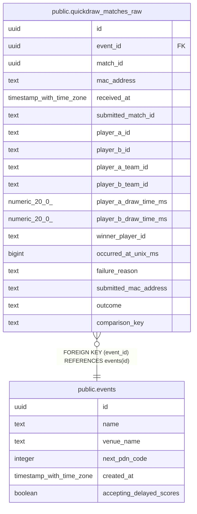

# public.quickdraw_matches_raw

## Columns

| Name | Type | Default | Nullable | Children | Parents | Comment |
| ---- | ---- | ------- | -------- | -------- | ------- | ------- |
| id | uuid |  | false |  |  |  |
| event_id | uuid |  | false |  | [public.events](public.events.md) |  |
| match_id | uuid |  | true |  |  |  |
| mac_address | text |  | true |  |  |  |
| received_at | timestamp with time zone | clock_timestamp() | false |  |  |  |
| submitted_match_id | text |  | false |  |  |  |
| player_a_id | text |  | false |  |  |  |
| player_b_id | text |  | false |  |  |  |
| player_a_team_id | text |  | true |  |  |  |
| player_b_team_id | text |  | true |  |  |  |
| player_a_draw_time_ms | numeric(20,0) |  | true |  |  |  |
| player_b_draw_time_ms | numeric(20,0) |  | true |  |  |  |
| winner_player_id | text |  | true |  |  |  |
| occurred_at_unix_ms | bigint |  | true |  |  |  |
| failure_reason | text |  | true |  |  |  |
| submitted_mac_address | text |  | true |  |  |  |
| outcome | text |  | true |  |  |  |
| comparison_key | text |  | true |  |  |  |

## Constraints

| Name | Type | Definition |
| ---- | ---- | ---------- |
| quickdraw_matches_raw_event_id_not_null | n | NOT NULL event_id |
| quickdraw_matches_raw_id_not_null | n | NOT NULL id |
| quickdraw_matches_raw_outcome_check | CHECK | CHECK ((outcome = ANY (ARRAY['completed'::text, 'tie'::text, 'failed'::text]))) |
| quickdraw_matches_raw_player_a_draw_time_ms_check | CHECK | CHECK (((player_a_draw_time_ms >= (0)::numeric) AND (player_a_draw_time_ms <= '18446744073709551615'::numeric))) |
| quickdraw_matches_raw_player_a_id_not_null | n | NOT NULL player_a_id |
| quickdraw_matches_raw_player_b_draw_time_ms_check | CHECK | CHECK (((player_b_draw_time_ms >= (0)::numeric) AND (player_b_draw_time_ms <= '18446744073709551615'::numeric))) |
| quickdraw_matches_raw_player_b_id_not_null | n | NOT NULL player_b_id |
| quickdraw_matches_raw_received_at_not_null | n | NOT NULL received_at |
| quickdraw_matches_raw_submitted_match_id_not_null | n | NOT NULL submitted_match_id |
| quickdraw_matches_raw_event_id_fkey | FOREIGN KEY | FOREIGN KEY (event_id) REFERENCES events(id) |
| quickdraw_matches_raw_pkey | PRIMARY KEY | PRIMARY KEY (id) |

## Indexes

| Name | Definition |
| ---- | ---------- |
| quickdraw_matches_raw_pkey | CREATE UNIQUE INDEX quickdraw_matches_raw_pkey ON public.quickdraw_matches_raw USING btree (id) |
| quickdraw_matches_raw_event_received_idx | CREATE INDEX quickdraw_matches_raw_event_received_idx ON public.quickdraw_matches_raw USING btree (event_id, received_at DESC, id DESC) |
| quickdraw_matches_raw_event_match_idx | CREATE INDEX quickdraw_matches_raw_event_match_idx ON public.quickdraw_matches_raw USING btree (event_id, match_id) |

## Relations

---

> Generated by [tbls](https://github.com/k1LoW/tbls)
