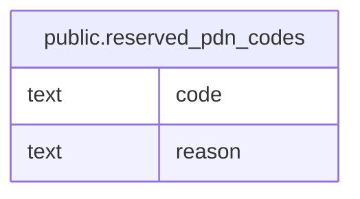

# public.reserved_pdn_codes

## Columns

| Name | Type | Default | Nullable | Children | Parents | Comment |
| ---- | ---- | ------- | -------- | -------- | ------- | ------- |
| code | text |  | false |  |  |  |
| reason | text |  | true |  |  |  |

## Constraints

| Name | Type | Definition |
| ---- | ---- | ---------- |
| reserved_pdn_codes_code_check | CHECK | CHECK ((code ~ '^[0-9]{4}$'::text)) |
| reserved_pdn_codes_code_not_null | n | NOT NULL code |
| reserved_pdn_codes_pkey | PRIMARY KEY | PRIMARY KEY (code) |

## Indexes

| Name | Definition |
| ---- | ---------- |
| reserved_pdn_codes_pkey | CREATE UNIQUE INDEX reserved_pdn_codes_pkey ON public.reserved_pdn_codes USING btree (code) |

## Relations

---

> Generated by [tbls](https://github.com/k1LoW/tbls)
